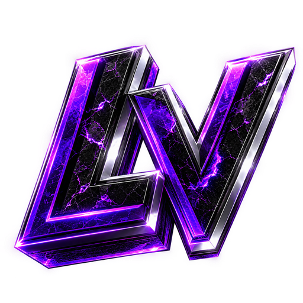

<p align="center"></p>

# LegacyV – Theme für BetterDiscord & Vencord

Dunkles Violett-Design im Stil des LegacyV Loadingscreens: Glas-Karten, Neon-Verlauf, Sora/Inter-Schrift und das **LV-Logo als Wasserzeichen im Chat**.

## Installation

**Direktlink (empfohlen, immer aktuell):**
```
https://raw.githubusercontent.com/BlizzGame/legacyv-theme/main/LegacyV.theme.css
```

### Vencord
1. Einstellungen → **Vencord → Themes** → *Online Themes*
2. Den Direktlink einfügen, Speichern, Theme aktivieren.

### BetterDiscord
- **Variante A:** `LegacyV.theme.css` herunterladen und in den Theme-Ordner legen (Einstellungen → Themes → *Open Themes Folder*), dann aktivieren.
- **Variante B:** Eine kleine Datei `LegacyV.theme.css` im Theme-Ordner anlegen, die nur `@import url("https://raw.githubusercontent.com/BlizzGame/legacyv-theme/main/LegacyV.theme.css");` enthält.

> Die Hilfsdateien (`core/*.css`, Logo) werden automatisch über **jsDelivr** (`cdn.jsdelivr.net/gh/BlizzGame/legacyv-theme@main/...`) nachgeladen. Dafür ist ein **öffentliches** Repo nötig.

## Struktur

| Datei | Zweck |
|---|---|
| `LegacyV.theme.css` | Einstiegspunkt: Meta-Header, `@import`s, Farben/Optionen |
| `core/legacyv.css` | Hauptdesign (Flächen, Buttons, Menüs, Chat, Scrollbars …) |
| `core/watermark.css` | LV-Logo als Chat-Wasserzeichen |
| `core/custom-font.css` | Sora + Inter |
| `core/hljs.css` | Codeblöcke inkl. Sprachlabels (u. a. Lua) |
| `assets/logo-watermark.webp` | Logo fürs Wasserzeichen (640 px, ~100 KB) |
| `assets/logo.png` | Logo allgemein |

Extern eingebunden bleibt nur **RadialStatus** (`DiscordStyles.github.io`), wie im Nocturnal-Original.

## Anpassen (alles oben in `LegacyV.theme.css`)

- **Farb-Presets:** Purple (Standard), Neon, Ice – Block ein-/auskommentieren.
- **Wasserzeichen:** `--lv-watermark-strength` (0 % aus … 15 % kräftig), `--lv-watermark-size`, `--lv-watermark-position`, oder `--lv-watermark-image` für ein eigenes Bild.
- **Verlaufstexte aus:** `--toggle-gradient: false;`
- **Schrift:** `--customFont`, `--displayFont`.

## Wichtige Hinweise

- **jsDelivr-Cache:** Änderungen an `@main` erscheinen teils erst nach bis zu 12 h. Sofort aktualisieren: `https://purge.jsdelivr.net/gh/BlizzGame/legacyv-theme@main/core/legacyv.css` aufrufen (analog für andere Dateien). Für stabile Releases lieber Tags nutzen (`@v1.0.0`) und die `@import`-URLs anpassen.
- **Discord-Updates:** Discord ändert regelmäßig interne Klassen. LegacyV nutzt deshalb `[class*="name_"]`-Selektoren und Discord-Variablen; trotzdem kann nach größeren Updates eine Stelle nachjustiert werden müssen.
- **Nicht übernommen:** Die `badges.css` aus Nocturnal enthält persönliche Badges einzelner Nutzer (feste Discord-IDs) und gehört nicht in ein eigenes Theme.

## Lizenz

Code: MIT (siehe `LICENSE`). Logo und Markenbilder in `assets/` © Blizz Development / LegacyV – alle Rechte vorbehalten.
